<!-- Animated header: edit scripts/make_terminal.py, then run it to regenerate both themes. -->
<picture>
  <source media="(prefers-color-scheme: dark)" srcset="assets/terminal-dark.svg">
  
</picture>

  
  
  
  

## 🔭 Featured projects

<table>
<tr>
<td width="50%" valign="top">

<a href="https://github.com/rajatjc/loonie-ledger">
<picture>
  <source media="(prefers-color-scheme: dark)" srcset="https://github-readme-stats.vercel.app/api/pin/?username=rajatjc&repo=loonie-ledger&theme=github_dark&hide_border=true">
  
</picture>
</a>

A demo Canadian neobank: Java payments, Python fraud scoring and Node.js compliance, talking only through
**Redis Streams**. Money moves only when both checks pass, and an ops console gives you a real `kubectl`
shell on Kubernetes.

</td>
<td width="50%" valign="top">

<a href="https://github.com/rajatjc/lsm-kv">
<picture>
  <source media="(prefers-color-scheme: dark)" srcset="https://github-readme-stats.vercel.app/api/pin/?username=rajatjc&repo=lsm-kv&theme=github_dark&hide_border=true">
  
</picture>
</a>

A storage engine from scratch in Java 21, the design behind Cassandra and RocksDB: write-ahead log,
SSTables, Bloom filters and compaction. **[Try the live demo](https://lsm-kv.onrender.com)** and
watch it flush and compact.

</td>
</tr>
</table>

Both have interactive playgrounds on my portfolio, **[rajatjc.github.io](https://rajatjc.github.io)**.

## 🎮 Play tic-tac-toe with me

Anyone on GitHub can play: pick a numbered square, and a GitHub Action makes your move on the board below.

<!--START:ttt-->
**Game #1** · next move: ⭕ · click a numbered square, then press **Create** on the issue that opens.

<table><tr><td align="center" width="64" height="64"><a href="https://github.com/rajatjc/rajatjc/issues/new?title=ttt%7Cmove%7C1%7C1&body=Just%20press%20%2A%2ACreate%2A%2A.%20The%20board%20in%20the%20README%20updates%20within%20a%20minute%20or%20two.">1️⃣</a></td><td align="center" width="64" height="64"><a href="https://github.com/rajatjc/rajatjc/issues/new?title=ttt%7Cmove%7C2%7C1&body=Just%20press%20%2A%2ACreate%2A%2A.%20The%20board%20in%20the%20README%20updates%20within%20a%20minute%20or%20two.">2️⃣</a></td><td align="center" width="64" height="64"><a href="https://github.com/rajatjc/rajatjc/issues/new?title=ttt%7Cmove%7C3%7C1&body=Just%20press%20%2A%2ACreate%2A%2A.%20The%20board%20in%20the%20README%20updates%20within%20a%20minute%20or%20two.">3️⃣</a></td></tr><tr><td align="center" width="64" height="64"><a href="https://github.com/rajatjc/rajatjc/issues/new?title=ttt%7Cmove%7C4%7C1&body=Just%20press%20%2A%2ACreate%2A%2A.%20The%20board%20in%20the%20README%20updates%20within%20a%20minute%20or%20two.">4️⃣</a></td><td align="center" width="64" height="64">❌</td><td align="center" width="64" height="64"><a href="https://github.com/rajatjc/rajatjc/issues/new?title=ttt%7Cmove%7C6%7C1&body=Just%20press%20%2A%2ACreate%2A%2A.%20The%20board%20in%20the%20README%20updates%20within%20a%20minute%20or%20two.">6️⃣</a></td></tr><tr><td align="center" width="64" height="64"><a href="https://github.com/rajatjc/rajatjc/issues/new?title=ttt%7Cmove%7C7%7C1&body=Just%20press%20%2A%2ACreate%2A%2A.%20The%20board%20in%20the%20README%20updates%20within%20a%20minute%20or%20two.">7️⃣</a></td><td align="center" width="64" height="64"><a href="https://github.com/rajatjc/rajatjc/issues/new?title=ttt%7Cmove%7C8%7C1&body=Just%20press%20%2A%2ACreate%2A%2A.%20The%20board%20in%20the%20README%20updates%20within%20a%20minute%20or%20two.">8️⃣</a></td><td align="center" width="64" height="64"><a href="https://github.com/rajatjc/rajatjc/issues/new?title=ttt%7Cmove%7C9%7C1&body=Just%20press%20%2A%2ACreate%2A%2A.%20The%20board%20in%20the%20README%20updates%20within%20a%20minute%20or%20two.">9️⃣</a></td></tr></table>

All-time: ❌ 0 wins · ⭕ 0 wins · 0 draws

**Recent moves**

- ❌ on square 5 by [@rajatjc](https://github.com/rajatjc) (game #1, 2026-10-18 23:42 UTC)

**Top players**

| Player | Moves |
| --- | --: |
| [@rajatjc](https://github.com/rajatjc) | 1 |
<!--END:ttt-->

## 💼 Experience

<b>IBM</b> · Software Developer, Maximo SaaS · <i>2026 – present</i>

 

Building a multi-tenant Maximo Manage-as-a-Service platform on Kubernetes and OpenShift.

- Re-keyed tenant identifiers so tenants can migrate between tenant groups, and automated Db2 setup on Amazon RDS.
- Built the SRE dashboard (Next.js, TypeScript) and a Go API that shows every tenant's lifecycle state.
- Wrote Terraform for AWS accounts with Atlantis plan and apply on pull requests, and run GitOps deploys with Argo CD.
- Hardened services by removing SQL injection vectors, adding secret scanning, and patching Go CVEs.

<b>IBM</b> · Software Developer, Envizi · <i>2024 – 2026</i>

 

Java and Spring Boot microservices for ESG reporting, on Kafka, Cassandra and Kubernetes.

- Designed a denormalized Cassandra schema that cut lookup latency by **65%** across 4 production clusters.
- Built a Kafka monitoring service for **30+ topics** and **500K+ events a day**, cutting alert fatigue by **90%**.
- Cut XBRL taxonomy load time from **5 s to 1 s**, and ranked 10,000+ ESRS concepts by relevance.
- Deployed services across **10+ Kubernetes clusters** in three regions with Argo CD GitOps.

<b>Earlier</b> · Konnect, Concordia University, Tejas Networks, Verbose Techlabs

 

- **Konnect:** Spring microservices on Kubernetes; deployments **40%** faster with multi-stage Docker builds.
- **Concordia University:** deployment tooling that cut developer effort by **44%**, and a Golden Key Scholarship for automation that saved 100+ hours a week.
- **Tejas Networks:** led a team of 3 migrating from ActiveMQ to Kafka, with **20%** faster processing.
- **Verbose Techlabs:** cut product search API latency from **550 ms to 200 ms**.

<b>Education and achievements</b>

 

- Master of Applied Computer Science, **Concordia University**, Montréal
- B.Tech in Information Technology, **Guru Gobind Singh Indraprastha University**, New Delhi
- **LeetCode** Knight (2018) · **CodeChef** 4★ (1848) · **HackerEarth** 1676
- Udacity Deep Learning Nanodegree

## 🛠️ What I work with

**Languages**
 

**Backend and data**
 

**Cloud and DevOps**
 

## 📊 GitHub stats

  <picture>
    <source media="(prefers-color-scheme: dark)" srcset="https://github-readme-stats.vercel.app/api?username=rajatjc&show_icons=true&count_private=true&hide_border=true&theme=github_dark">
    
  </picture>
  <picture>
    <source media="(prefers-color-scheme: dark)" srcset="https://github-readme-stats.vercel.app/api/top-langs/?username=rajatjc&layout=compact&langs_count=8&hide_border=true&theme=github_dark">
    
  </picture>

  <picture>
    <source media="(prefers-color-scheme: dark)" srcset="https://streak-stats.demolab.com/?user=rajatjc&hide_border=true&theme=dark">
    
  </picture>

<picture>
  <source media="(prefers-color-scheme: dark)" srcset="https://raw.githubusercontent.com/rajatjc/rajatjc/output/github-snake-dark.svg">
  
</picture>

⚡ <b>Recent activity</b> (updated every 6 hours)

<!--START:recent-->
### 📁 Recent Repositories
- **[lsm-kv](https://github.com/rajatjc/lsm-kv)** — LSM-tree key-value store in Java: WAL, SSTables, Bloom filte...
  - Last updated: 2026-10-18
- **[loonie-ledger](https://github.com/rajatjc/loonie-ledger)** — A demo Canadian neobank: Java, Python and Node.js services c...
  - Last updated: 2026-10-18
- **[rajatjc](https://github.com/rajatjc/rajatjc)** — None
  - Last updated: 2026-10-18

### 🔥 Recent Activity
- 🚀 **Pushed** to [rajatjc/lsm-kv](https://github.com/rajatjc/lsm-kv) — 2026-10-17
- ✨ **Created** [rajatjc/lsm-kv](https://github.com/rajatjc/lsm-kv) — 2026-10-17

---
*Last updated: 2026-10-18 19:48 UTC*
<!--END:recent-->

## 🍁 Fun fact

> **Loonie Ledger** is named after the *loonie*, Canada's $1 coin, which got its nickname from the loon on one side.
> Try sending 10,000 of them in one go and my bank's compliance service puts the transfer on hold for review.

